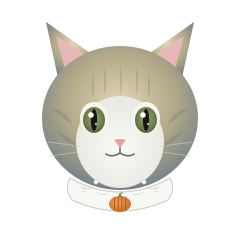
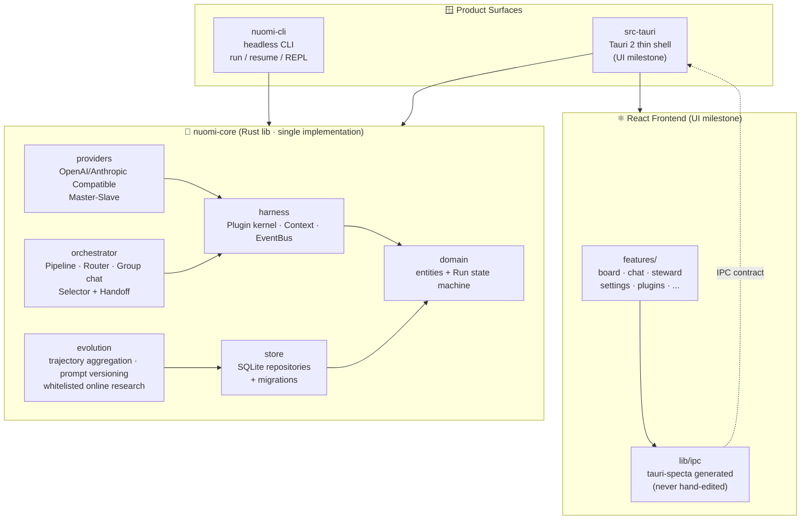

<div align="center">

# 🐱 nuomi



### An Agent Harness kernel guarded by a blue golden British Shorthair

**Plugin-based Agent Harness kernel + terminal acceptance entry** · Provider Master-Slave orchestration · Role/Team multi-agent collaboration · Long-term Memory · Self-Evolution

[简体中文](README.md) | **English**

```text
            ╭──────────────────────────────────────────────╮
            │                  nuomi                       │
            │       "everything is a plugin."              │
            ╰──────────────────────────────────────────────╯
                          │            │            │
                   ┌────▼────┐  ┌────▼────┐  ┌────▼────┐
                   │ Provider│  │  Team   │  │Evolution│
                   │Master/Slave│ │Selector+Handoff│ │GEPA+Memory│
                   └─────────┘  └─────────┘  └─────────┘
                        │            │            │
                        └────────────┼────────────┘
                                     ▼
                            ┌────────────────┐
                            │  Rust Plugin   │
                            │    Kernel      │
                            │ (Cordis-idea)  │
                            └────────────────┘
                                     │
                        ┌────────────┼────────────┐
                        ▼            ▼            ▼
                   ┌─────────┐ ┌─────────┐ ┌─────────┐
                   │  Loop   │ │ Memory  │ │   MCP   │
                   │ Engine  │ │ + Hook  │ │stdio/HTTP│
                   └─────────┘ └─────────┘ └─────────┘
```

`Rust` · `Tauri 2` · `React 18` · `TypeScript strict` · `SQLite (WAL)` · `tokio`

</div>

---

## 📖 What is it

**nuomi** is a **plugin-based Agent Harness kernel**.

nuomi is the name of a blue golden British Shorthair — blue-grey tipped guard hairs shading to a honey undercoat, round face and round eyes, often wearing a white crochet collar with a tiny orange pumpkin dangling at the chest. The project takes the cat's name; it builds every part an Agent Harness needs (Loop Engine, SystemPrompt, Memory, MCP, Hooks, Commands, Skills, Plugins, ReAct) as a **plugin**, running on a self-developed Rust plugin kernel (inspired by [Cordis](https://cordis.moe/zh-CN/guide/) but with no Node runtime).

> In one sentence: **everything is a plugin · observable (append-only event sourcing) · orchestrable (Pipeline/Router/group chat) · evolvable (GEPA-style reflective evolution + whitelisted online learning)**.

---

## ✨ Features

|  | Feature | Description |
|---|---|---|
| 🧩 | **Rust Plugin Kernel** | Unified `Plugin` trait (registration / lifecycle / event subscription); new components never touch kernel scheduling code |
| 🎭 | **Provider Master-Slave** | OpenAICompatible / AnthropicCompatible dual protocols; master provider routing + failover + sub-providers-as-tools |
| 👥 | **Role / Team Multi-Agent** | Pipeline serial · Router dispatch · **Group chat = Selector picks + Handoff hands over** · WhiteBoard shared blackboard |
| 🧠 | **Long-term Memory** | SQLite append-only event sourcing; cross-session memory retrieval injected into context (vector search deferred) |
| 🧬 | **Self-Evolution** | Iteratively evolves the SystemPrompt from user profile + memory + historical trajectories; whitelisted online research merged in with authorization |
| 🖥️ | **headless CLI** | `nuomi run "<task>"` one-shot · `nuomi resume <session>` resumption · REPL multi-turn chat |
| 🎨 | **Hand-drawn Paper UI** | Cartoon paper hand-drawn line-art style · 4 themes (paper light / blue grid / chalkboard dark / high contrast) · WCAG-guarded |
| 🔌 | **Third-party Plugins (NPP)** | Python / Node plugins via ndjson JSON-RPC 2.0; tools + hooks + event subscriptions in one bundle |
| 🤖 | **App Steward AI** | App-level steward conversing with the user at the meta layer; 6 capability modules + 5 built-in dev roles (research/design/dev/test/acceptance) |

---

## 🏗️ Architecture



**Boundary iron rules**:
1. `commands/` only validates and forwards parameters; all business logic lives in `domain/` and `orchestrator/`
2. The frontend never touches the filesystem / processes / SQL directly — everything goes through the IPC contract
3. The orchestrator depends only on the `AgentAdapter` trait and is vendor-agnostic
4. **Run state machine**: every state transition must persist the `state_changed` EventRecord BEFORE any external side effect

```
queued ─▶ running ⇄ awaiting_approval ─▶ succeeded
             │   │
             │   └──▶ cancelled        (user-initiated)
             └──────▶ failed | timed_out
Crash recovery: running --(orphan heartbeat timeout)--> interrupted ─▶ requeue
```

---

## 🚀 Quick Start

### Prerequisites

| Tool | Version | Used for |
|---|---|---|
| Rust | edition 2021 (rustc ≥ 1.89) | kernel + CLI |
| Node | ≥ 20 (pnpm) | frontend + bindings generation |
| Tauri 2 CLI | installed via `pnpm` | desktop shell (UI milestone) |

Linux additionally needs: `libwebkit2gtk-4.1-dev libgtk-3-dev libayatana-appindicator3-dev librsvg2-dev libxdo-dev libssl-dev patchelf`

### headless CLI (current main battlefield)

```bash
# One-shot task
nuomi run "Refactor this module into a trait"

# Resume the last session
nuomi resume <session-id>

# Enter the REPL
nuomi
> /new       # start a new session
> /sessions  # list sessions
> /exit      # quit
```

### Desktop dev mode (when the UI milestone returns)

```bash
pnpm install
pnpm tauri dev      # desktop development
pnpm tauri build    # bundle
```

### Quality Gates

```bash
cargo fmt --all
cargo clippy --all-targets -- -D warnings    # must be zero-warning
cargo test                                    # Rust tests
pnpm typecheck && pnpm lint                   # frontend static checks
pnpm test                                     # vitest unit tests
pnpm coverage:rust                            # Rust line coverage
```

> **Done = `lint + typecheck + tests` all green**; attach a command output summary when reporting.

---

## 🔌 Third-party Plugins

nuomi supports writing plugins in **Python / Node**, connected via the **NPP protocol** (ndjson JSON-RPC 2.0, one message per line). A single plugin can contribute: **tools + hooks + event subscriptions + editor commands/overlays**.

```toml
# examples/plugins/upper/plugin.toml
id = "upper"
name = "Uppercase Tools"
version = "0.1.0"
api_version = 1
entry = ["python3", "plugin.py"]        # or ["node", "plugin.cjs"]

[permissions]
fs.read = []
fs.write = []
network = []
shell = false

[[tools]]
name = "upper"
description = "Uppercase the given text"
input = { type = "object", properties = { text = { type = "string" } }, required = ["text"] }

[[hooks]]
point = "post_tool_call"
order = 100

[[events]]
topic = "session.*"
```

```python
# examples/plugins/upper/plugin.py — zero-dependency, ~70 lines cover the whole protocol
def handle(method, params, request_id):
    if method == "initialize":
        reply(request_id, {"api_version": 1,
                            "capabilities": {"tools": True, "hooks": True, "events": True}})
    elif method == "tools/call":
        text = params.get("arguments", {}).get("text", "")
        reply(request_id, {"content": [{"type": "text", "text": text.upper()}]})
    # ... hooks / events / shutdown
```

Drop the plugin directory into `.nuomi/plugins/` (or set `NUOMI_PLUGIN_PATH`) and the host discovers and loads it. Full protocol: [`docs/plugins/`](docs/plugins/).

---

## 🎨 Hand-drawn Paper UI

nuomi's frontend uses a **cartoon paper hand-drawn line-art style** — strokes as language, paper as container, wobble as personality, handwriting as hierarchy.

| Theme | Style | Best for |
|---|---|---|
| 📄 `paper-light` | kraft paper + handwriting | daytime default |
| 📒 `grid-notebook` | blue grid notebook | long-form reading |
| 🪟 `chalkboard-dark` | chalkboard dark | nighttime |
| ⬛ `high-contrast` | high contrast | accessibility |

- Self-hosted fonts (Patrick Hand / Kalam / Caveat via `@fontsource`), works offline
- ~45 hand-drawn icon paths built in-house (24×24 viewBox, strokeWidth 1.8, `currentColor` inheritance)
- 4×28 WCAG pairs permanently guarded among 349 tests (text ≥4.5:1, UI ≥3:1)

See [ADR 0008](docs/adr/0008-handdrawn-ui-themes.md).

---

## 🧭 Roadmap

```text
✅ K0  workspace scaffolding + migration framework
✅ K1  plugin kernel (Plugin / Context / EventBus)
✅ K2  storage layer repositories
✅ K3  provider layer + Master-Slave orchestration
✅ K4  Loop Engine (ReAct) + SystemPrompt plugin
✅ K5  Memory / Hook / MCP plugins
✅ K6  Role/Team orchestration (Pipeline · Router · group chat) + WhiteBoard
✅ K7  headless CLI (run / resume / REPL)
✅ K8  Self-Evolution (reflective evolution + whitelisted online learning)
───────────  Delivered milestones  ───────────
✅ M-CLI1   CLI Agent integration (adapters/cli + AgentProfile)
✅ M-TEAM1  Team orchestration in the desktop shell (team_runner + Run lifecycle)
✅ M-BOT1   Telemetry/Bot integration (Feishu signed webhook + bulk telemetry export)
───────────  Polish & enhancement phase  ───────────
🔲 Light-theme polish · Monaco experience · self-organized team dry-run preview · ...
```

---

## 📚 Docs

| Directory | Contents |
|---|---|
| [`pr.md`](pr.md) | ★ **authoritative requirements** |
| [`AGENTS.md`](AGENTS.md) | top-level context for AI developers (team / rules / workflow) |
| [`docs/specs/`](docs/specs/) | authoritative SPECs (harness-kernel-v1 · cli-agents-m1 · team-shell-m1 · steward-module · ...) |
| [`docs/adr/`](docs/adr/) | architecture decision records (0001 Rust plugin kernel · 0008 hand-drawn UI · 0009 plugin sideload · 0013 IM model · ...) |
| [`docs/plugins/`](docs/plugins/) | plugin development docs (manifest / NPP protocol / tutorial) |
| [`examples/plugins/`](examples/plugins/) | third-party plugin examples (upper: tools + hooks + events) |
| [`migrations/`](migrations/) | numbered SQL migrations (**append-only**, never edited once shipped) |

---

## 🛠️ Tech Stack (locked)

| Layer | Choice |
|---|---|
| Desktop shell | **Tauri 2** (Rust core + system WebView) |
| Frontend | **React 18 + TypeScript(strict) + Vite** |
| UI state | **Zustand** (local) + **TanStack Query** (IPC data state) |
| Styling | **Tailwind CSS** (dark-first, design-token based) |
| Backend core | **Rust (edition 2021) + tokio** async runtime |
| Persistence | **SQLite** (rusqlite + WAL, numbered migrations append-only) |
| IPC contract | **tauri-specta** generated TS bindings — single source of truth for the contract |
| Toolchain | pnpm · cargo · vitest · cargo test/clippy |

> Swapping any of these requires an ADR first and explicit user approval.

---

## 🧪 Commands Cheat Sheet

```bash
# ── Frontend ──
pnpm install                 # install deps
pnpm tauri dev               # desktop dev mode
pnpm tauri build             # bundle
pnpm typecheck && pnpm lint  # frontend static checks
pnpm test                    # vitest unit tests
pnpm contracts:gen           # regenerate IPC bindings (required after changing Rust types)

# ── Rust ──
cargo fmt --all                              # format
cargo clippy --all-targets -- -D warnings    # lint, zero warnings
cargo test                                   # Rust tests
pnpm coverage:rust                           # line coverage summary
pnpm coverage:rust:html                      # HTML coverage report
```

---

## 🤝 AI Dev Team

nuomi is built by a collaborating AI dev team (configured in `.opencode/agent/`):

| Member | Role | Owns |
|---|---|---|
| 🎼 **conductor** | planning & breakdown, dispatch, cross-layer integration, final acceptance | cross-cutting |
| 🎨 **ui-engineer** | React feature implementation and visual quality | `src/**` |
| 🦀 **core-engineer** | domain model, plugin kernel, orchestration engine, storage, Evolution | `crates/nuomi-core/src/**` |
| 🌉 **bridge-engineer** | headless CLI, agent adapters, IPC contract | `crates/nuomi-cli` + `src-tauri` + `src/lib/ipc` |
| 🛡️ **qa-guardian** | review, regression tests, quality gates | tests & review reports |

---

## 📜 License

**MIT** — see [`Cargo.toml`](Cargo.toml) `workspace.package.license`.

---

<div align="center">

**🐱 Kernel first, UI later.**

*"Create an era-defining Agent project that transcends multi-agent systems and personal agents."*
*"UI/UX will exceed user expectations."*
*"Innovative breakthroughs in token consumption, cache hits, and CLI-native agent communication & collaboration."*
— `pr.md`

</div>
